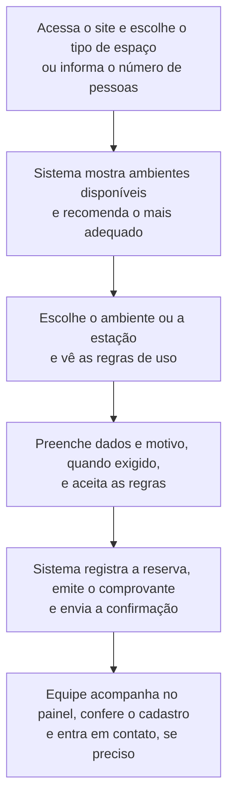

# Fluxo principal de reserva

1. O usuário acessa o site e escolhe o tipo de espaço ou informa quantas pessoas vão participar.
2. O sistema mostra os ambientes disponíveis na data e horário escolhidos e recomenda o mais adequado.
3. O usuário escolhe o ambiente (ou a estação, no mapa da sala) e vê as regras de uso.
4. O usuário preenche seus dados, o motivo (quando exigido) e aceita as regras.
5. O sistema registra a reserva, emite o comprovante e envia a confirmação por WhatsApp/e-mail.
6. A equipe da Mútua-PI acompanha a reserva no painel, confere o cadastro e, se preciso, entra em contato.

