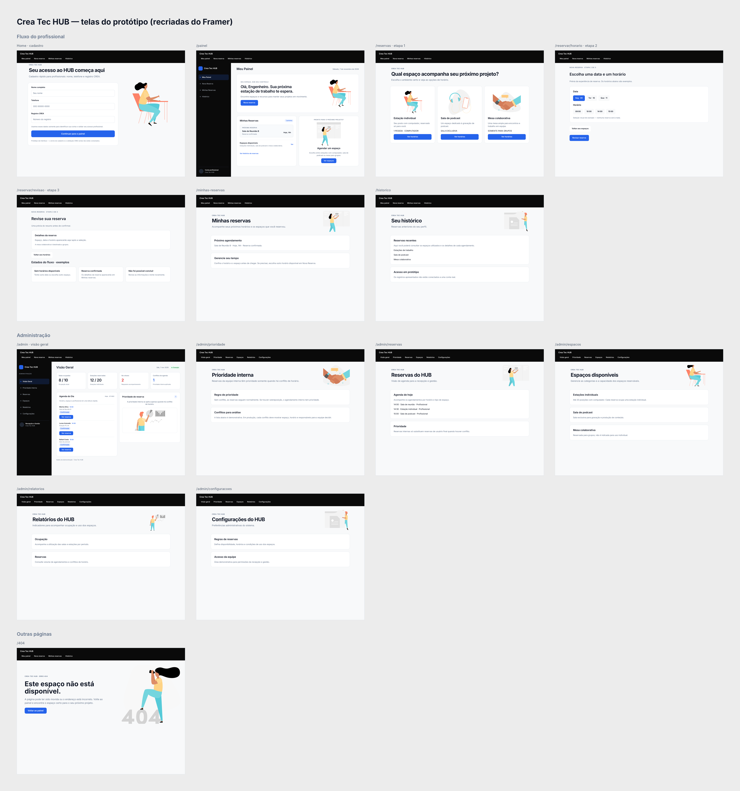

# Design

O design oficial do projeto está no Framer:

**[Functional Technology — projeto no Framer](https://framer.com/projects/Functional-Technology--oPvtlPE6L7zY6TVoD80Q-4pu9H)**

## Regras

- O Framer é a fonte de verdade para telas, componentes e identidade visual aplicada.
- O protótipo do MVP e as telas incluídas no PDF da análise de requisitos não são referência de design.
- O acesso ao projeto depende de permissão no workspace do Framer.

## Telas do protótipo

Para quem não tem acesso ao Framer, as telas do protótipo foram recriadas em HTML a
partir do projeto no Framer (14/11/2026) e exportadas em PNG de alta resolução
(1200px de largura em 2x, página inteira). Medidas, espaçamentos, raios, cores e
tipografia foram lidos camada a camada no painel do Framer; as ilustrações são os SVGs
originais do projeto. Em caso de divergência, vale o que está no Framer.



### Fluxo do profissional

| Tela | Rota no Framer | Imagem |
|---|---|---|
| Cadastro | `/` (Home) | [01-home-cadastro](design/telas/01-home-cadastro.png) |
| Meu painel | `/painel` | [02-meu-painel](design/telas/02-meu-painel.png) |
| Nova reserva · etapa 1 (espaço) | `/reservas` | [04-nova-reserva-etapa1-espacos](design/telas/04-nova-reserva-etapa1-espacos.png) |
| Nova reserva · etapa 2 (data e horário) | `/reservar/horario` | [05-nova-reserva-etapa2-horario](design/telas/05-nova-reserva-etapa2-horario.png) |
| Nova reserva · etapa 3 (revisão) | `/reservar/revisao` | [06-nova-reserva-etapa3-revisao](design/telas/06-nova-reserva-etapa3-revisao.png) |
| Minhas reservas | `/minhas-reservas` | [07-minhas-reservas](design/telas/07-minhas-reservas.png) |
| Histórico | `/historico` | [08-historico](design/telas/08-historico.png) |

A etapa 2 é a mesma página para os três espaços (ver pendência D2 em
[Pendências](10-pendencias.md)).

### Administração

| Tela | Rota no Framer | Imagem |
|---|---|---|
| Visão geral | `/admin` | [09-admin-visao-geral](design/telas/09-admin-visao-geral.png) |
| Prioridade interna | `/admin/prioridade` | [11-admin-prioridade](design/telas/11-admin-prioridade.png) |
| Reservas | `/admin/reservas` | [12-admin-reservas](design/telas/12-admin-reservas.png) |
| Espaços | `/admin/espacos` | [13-admin-espacos](design/telas/13-admin-espacos.png) |
| Relatórios | `/admin/relatorios` | [14-admin-relatorios](design/telas/14-admin-relatorios.png) |
| Configurações | `/admin/configuracoes` | [15-admin-configuracoes](design/telas/15-admin-configuracoes.png) |

Na `/admin` o menu superior é o do profissional, diferente das demais páginas
administrativas. A recriação mantém o que está no Framer; a correção está registrada
como pendência D1 em [Pendências](10-pendencias.md).

### Outras páginas

| Tela | Rota no Framer | Imagem |
|---|---|---|
| Página não encontrada | `/404` | [16-erro-404](design/telas/16-erro-404.png) |

### Tokens

| Token | Valor | Origem no Framer |
|---|---|---|
| Azul elétrico | `#2563EB` | estilo de cor "Crea Tec — Azul elétrico" |
| Gelo | `#F8F9FA` | estilo de cor "Crea Tec — Gelo" |
| Preto profundo | `#0A0A0A` | estilo de cor "Crea Tec — Preto profundo" |
| Texto | `#111827` | estilo de cor "Crea Tec — Texto" |
| Texto secundário | `#64748B` | estilo de cor "Crea Tec — Texto secundário" |
| Borda de cartão | `#E1E7EE`, 1px | borda dos cartões |
| Fonte | Inter | todas as camadas de texto |
| Rótulo (eyebrow) | Inter Bold 11px, espaçamento 0,08em, maiúsculas | rótulos das páginas (a `/404` usa o estilo de texto "Crea Tec — Rótulo") |
| Título de página | Inter Bold 36px, altura 1,1, espaçamento −0,03em | cabeçalhos |
| Raios | cartões 14px (formulário 16px, admin 12px), botões 8px (10px nos grandes) | camadas |

### Código da recriação

O HTML fica em [`design/prototipo/`](design/prototipo/) e pode servir de ponto de partida
para o frontend:

- `css/crea-tec.css` — tokens e estilos, com os valores lidos no Framer.
- `assets/` — as sete ilustrações SVG originais do projeto no Framer.
- `telas/` — uma página HTML por tela, gerada por `build.py`.
- `render.py` e `canvas.py` — regeram os PNGs e o canvas em `design/telas/`
  (Python com Playwright e Pillow).

```bash
cd docs/design/prototipo
python3 build.py && python3 render.py && python3 canvas.py
```

## Requisitos que o design precisa atender

| ID | Requisito |
|---|---|
| RNF01 | Web responsivo, para celular e computador |
| RNF02 | Reserva em poucos passos, com linguagem simples |
| RNF03 | Tons de azul, amadeirado e branco gelo, evitando branco puro |
| RNF06 | Contraste, navegação por teclado e textos alternativos |
